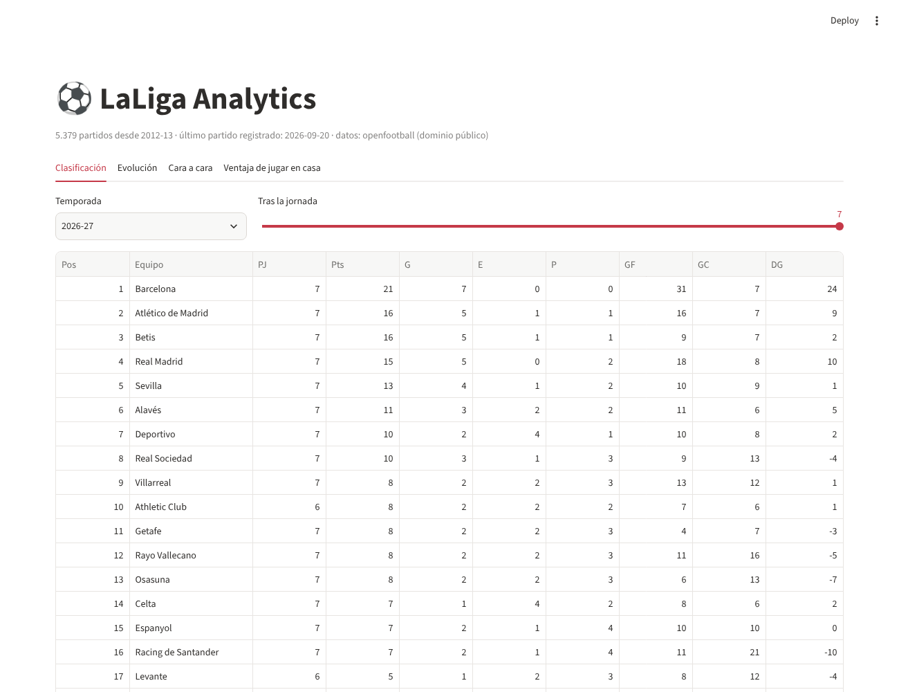
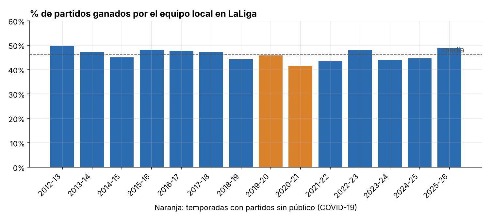
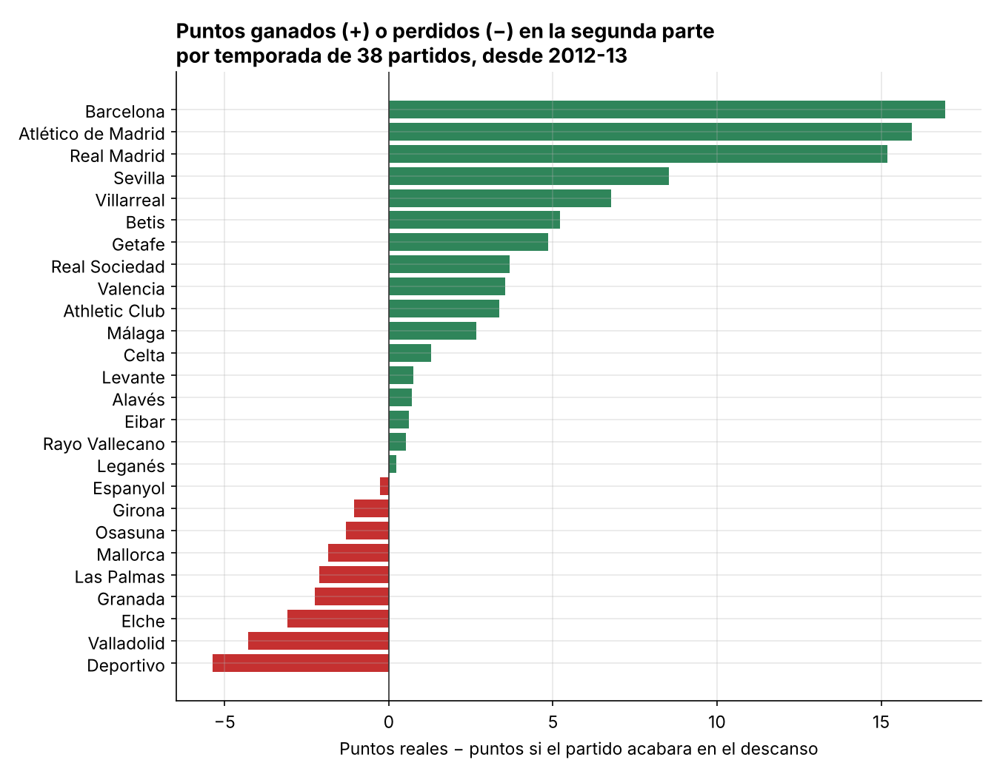
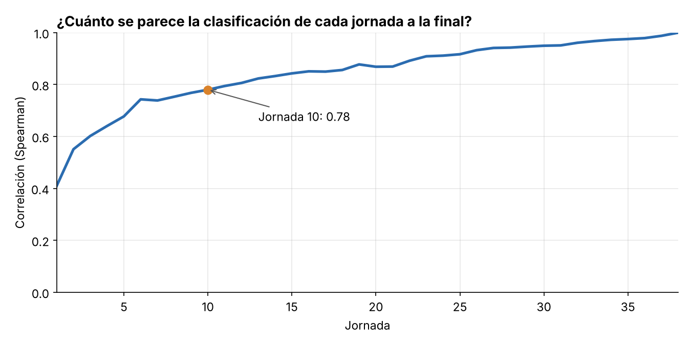

# ⚽ LaLiga Analytics

Pipeline de datos de LaLiga que **se actualiza solo**, con un modelo de datos en SQL probado con tests, tres análisis y un dashboard interactivo.

### 👉 [Ver el dashboard en vivo](https://laliga-data.streamlit.app/)

**Stack:** Python · SQL · dbt · DuckDB · pandas · Streamlit · Plotly · GitHub Actions



---

## Tres preguntas y lo que dicen los datos

Más de 5.300 partidos de Primera División desde la temporada 2012-13.

### 1. ¿Cuánto vale jugar en casa? ¿Y sin público?

Con público, el local gana el **46,6 %** de los partidos. En los 490 partidos jugados a puerta cerrada por la COVID-19, esa cifra bajó al **41,4 %**, y el margen medio de goles del local casi se redujo a la mitad (de +0,41 a +0,22). La diferencia es significativa (p ≈ 0,03): **el público explica parte de la ventaja local, pero no toda.**



→ [notebooks/01_ventaja_local.ipynb](notebooks/01_ventaja_local.ipynb)

### 2. ¿Quién gana y quién pierde partidos en la segunda parte?

Si los partidos acabaran en el descanso, Barcelona, Atlético y Real Madrid tendrían **unos 15-17 puntos menos por temporada**. Además casi nunca dejan escapar una ventaja (entre el 7 % y el 14 % de las veces). Deportivo, Valladolid y Elche, en cambio, pierden puntos tras el descanso de forma sistemática.



→ [notebooks/02_remontadas.ipynb](notebooks/02_remontadas.ipynb)

### 3. ¿Cuánto dicen las primeras 10 jornadas?

Bastante, pero no todo. La correlación entre la clasificación de la jornada 10 y la final es de **0,78**, y el 79 % de los equipos en puestos de Champions en la jornada 10 terminan ahí. Pero el líder de la jornada 10 solo fue campeón en **6 de 13** temporadas, y solo el **54 %** de los que están en descenso acaba bajando.



→ [notebooks/03_primeras_jornadas.ipynb](notebooks/03_primeras_jornadas.ipynb)

---

## Cómo funciona

```
openfootball (JSON)  →  pipeline/download.py  →  data/processed/matches.csv
                                                        │
                                                        ▼
                                  dbt + DuckDB: staging → intermediate → marts
                                  (17 tests de calidad de datos)
                                                        │
                                                        ▼
                         pipeline/export_marts.py  →  data/marts/*.parquet
                                                        │
                                   ┌────────────────────┴────────────────────┐
                                   ▼                                         ▼
                          notebooks/ (análisis)                 app/ (dashboard Streamlit)
```

Una GitHub Action ([update-data.yml](.github/workflows/update-data.yml)) se ejecuta cada día. Descarga los partidos nuevos, reconstruye y prueba los modelos, y hace commit solo si hay cambios.

### Modelo de datos (dbt)

| Modelo | Qué contiene |
|---|---|
| `stg_matches` | Un partido por fila con nombres de equipo normalizados (la fuente usa varios nombres para el mismo club; ver `seeds/team_names.csv`) |
| `int_team_matches` | Cada partido desde el punto de vista de cada equipo |
| `fct_matches` | Partidos jugados con resultado al descanso y final |
| `fct_standings_by_matchday` | Clasificación acumulada tras cada jornada |
| `fct_final_standings` | Clasificación final (o actual) de cada temporada |
| `mart_home_advantage` | Ventaja local por temporada, separando partidos sin público |
| `mart_comebacks` | Puntos ganados o perdidos tras el descanso por equipo y temporada |

**Tests:** unicidad y no nulos, valores permitidos, rangos y tests propios: 380 partidos por temporada, 38 por equipo y 20 equipos por temporada. Hay además un **aviso** que detecta temporadas terminadas a las que les faltan resultados en la fuente.

### Validación

Los campeones y sus puntos calculados coinciden con los oficiales de 2012-13 a 2023-24, comprobados uno a uno (por ejemplo, Barcelona 100 puntos en 2012-13, Atlético 90 en 2013-14 y Real Madrid 95 en 2023-24).

---

## Ejecutarlo en local

```bash
python -m venv .venv && source .venv/bin/activate
pip install -r requirements.txt

make data       # descarga los partidos
make transform  # dbt build: modelos + tests
make export     # exporta las tablas a Parquet
make app        # abre el dashboard en http://localhost:8501
```

Sin `make`: `python pipeline/download.py`, `cd dbt && dbt build --profiles-dir .`, `python pipeline/export_marts.py` y `streamlit run app/streamlit_app.py`.

## Limitaciones (conocidas y documentadas)

- **Fuente:** [openfootball/football.json](https://github.com/openfootball/football.json), de dominio público (CC0). Solo trae resultados (no tiros, xG ni alineaciones) y la temporada en curso puede ir con algunas semanas de retraso.
- A la temporada **2024-25 le falta la jornada 38** en la fuente. El test de aviso lo detecta y el análisis 3 excluye esa temporada.
- A unos 25-40 partidos por temporada les falta el resultado al descanso; el análisis 2 los excluye.
- La posición se desempata por diferencia de goles. LaLiga usa antes el enfrentamiento directo, así que con empates a puntos el orden puede diferir del oficial.

## Próximos pasos

- Añadir una segunda fuente con estadísticas de partido (tiros, xG) para analizar si los equipos "merecen" su posición.
- Un modelo sencillo de predicción (rating Elo) y medir su acierto.

---

Datos: openfootball (CC0). Código: licencia MIT.
